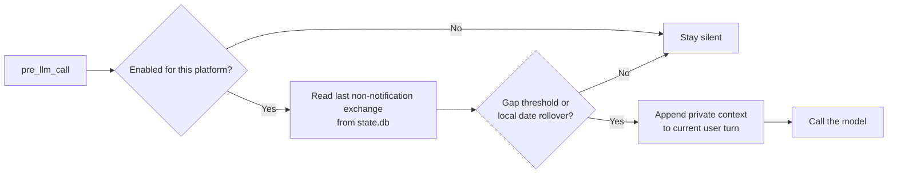

<p align="center">
  
</p>

<h1 align="center">time-gap</h1>

<p align="center">
  <strong>Give Hermes a sense of elapsed time—without timestamping every message.</strong>
</p>

<p align="center">
  
  
  
  
</p>

`time-gap` is a tiny [Hermes](https://github.com/NousResearch/hermes-agent) plugin that tells the model when a conversation has meaningfully aged. It stays completely silent during a continuous chat, then adds one private, coarse-grained hint when the configured threshold is crossed—or when the user's calendar rolls past midnight.

> **The model notices that time passed. The conversation still feels natural.**

## See it in one glance

```text
10:00  You       "Let's continue with option B."
10:01  Assistant "I'll draft the migration plan."

10:06  You       "Start with the schema."          → no note; conversation is fresh

         · · · two days pass · · ·

Friday You       "Can we ship this today?"         → private time-gap context added
```

The model receives an ephemeral hint like this at API-call time:

```text
[time-gap: about 2 days have passed since the previous exchange]
```

It is instructed to **factor the hint in, never quote it**. That is enough to make the model reconsider stale plans, dates, deadlines, availability, and other time-sensitive context.

## Why selective time awareness?

Stamping every turn adds noise and makes chat feel mechanical. `time-gap` treats silence as the default, so the signal only appears when it carries information.

| Situation | What happens |
| --- | --- |
| Active back-and-forth | Nothing is injected |
| Gap reaches `min_gap_seconds` | A coarse elapsed-time hint is injected |
| Chat crosses local midnight | A date-rollover hint is injected, even for a short gap |
| New session / no assistant reply | Nothing is injected |
| Excluded platform, such as `cron` | Nothing is injected |
| Missing DB, read error, or clock hiccup | Fails open; the turn continues untouched |

## How it works



- **Restart-safe:** elapsed time comes from the last persisted assistant message outside notification turns, not in-process memory.
- **Prompt-cache friendly:** the note rides on the current user turn and never touches the cached system-prompt prefix.
- **Transcript-clean:** injected context is used for the API call only and is never written back to session history.
- **Timezone-aware:** midnight follows Hermes' configured timezone through `hermes_time.get_timezone`, not UTC.
- **Writer-friendly:** `state.db` is opened with SQLite `mode=ro`, including correct reads from an active WAL.

## Install

Clone the plugin directly into Hermes and enable it:

```bash
cd ~/.hermes/plugins
git clone https://github.com/Randool/time-gap.git
hermes plugins enable time-gap
```

This creates the following plugin directory:

```text
~/.hermes/plugins/time-gap/
├── __init__.py
└── plugin.yaml
```

To customize its behavior, edit the generated entry in `~/.hermes/config.yaml` and reload Hermes:

```yaml
plugins:
  enabled:
    - time-gap
  entries:
    time-gap:
      enabled: true
      min_gap_seconds: 7200
      notify_date_change: true
      exclude_platforms:
        - cron
      debug: false
```

The defaults are intentionally conservative: a **120-minute threshold**, date-change detection enabled, and `cron` excluded.

## Configuration

| Option | Default | Purpose |
| --- | ---: | --- |
| `enabled` | `true` | Master switch for the plugin |
| `min_gap_seconds` | `7200` | Minimum elapsed time before a note is injected |
| `notify_date_change` | `true` | Also trigger when the user's local calendar date changes |
| `exclude_platforms` | `[cron]` | Platforms that should never receive a time-gap note |
| `exclude_user_prefixes` | `[]` | Exact prefixes identifying background user turns in a shared session |
| `debug` | `false` | Write decisions to the plugin-local `debug.log` |

### Notifications in the same conversation

Background reminders can share a session with human messages. Their assistant
replies must not reset the human conversation's clock. When available, the plugin
recognizes `display_kind: notification` and nonempty
`display_metadata.notification_category` on persisted messages. A marked user
message excludes its entire turn, including unmarked tool-call assistant messages.
`hidden` alone is not treated as proof of automation.

For integrations that identify events with a text marker, configure exact prefixes:

```yaml
exclude_user_prefixes:
  - "[background-event "
```

Use the marker actually emitted by your integration. It is checked only at the
start of user text, including text blocks in multimodal messages. Matching current
turns receive no time-gap hint; matching historical turns do not reset the clock.
Unmarked automated messages cannot be distinguished from human messages, so the
producer must supply metadata or a configured prefix. Old databases without the
optional display columns continue to work with prefix matching.

### Human-friendly, intentionally imprecise

The hint gets coarser as the gap grows:

| Elapsed gap | Example wording |
| --- | --- |
| Under an hour | `about 40 minutes` |
| Several hours | `about 5 hours` |
| Around one day | `about a day` |
| Multiple days | `about 3 days` |

Exact wall-clock time is never injected. If precision matters, the model can re-ground using the current system time.

## Design guarantees

1. The **last assistant reply outside notification turns** defines the previous completed exchange. A newly persisted user turn cannot accidentally reset the clock. A long-running human request still counts as active conversation until its reply.
2. Gap and date rollover are **independent triggers**. A 10-minute pause across midnight can matter even when the normal threshold is two hours.
3. Multi-day messages avoid redundant wording: `about 3 days` already implies a date change.
4. Every failure path returns no context rather than blocking a user turn.

## Test

The suite covers session isolation, WAL visibility, platform exclusions, graded phrasing, midnight rollover, disabled settings, and fail-open behavior.

```bash
python -m pytest tests/test_time_gap.py -q
```

From a Hermes source checkout, use:

```bash
python -m pytest plugins/time-gap/tests/test_time_gap.py -q
```

---

<p align="center">
  Small signal. Better temporal judgment. Zero conversation clutter.
</p>
